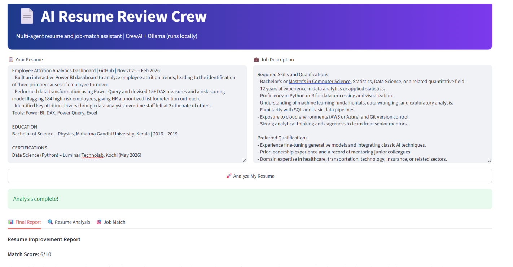

# # Agentic RAG School Assistant
### Local LLM agent with tool calling, hybrid search, MySQL and MCP

### An agentic RAG chatbot for school operations

A local AI assistant for a fictional school, **Excellent Public School**. Parents, students and staff ask questions in plain English and get answers about timetables, exam results, attendance, teachers, inventory and school policies. A local LLM chooses between tools, searches a policy document with hybrid search, and queries a MySQL database. It comes with a Streamlit chat interface and an MCP server.


-orange)


> **All data in this project is synthetic** (generated names, marks and attendance). The school, phone number and email are fictional.



---

## Problem it solves

School offices answer the same questions again and again: *"What is the Grade 5 timetable?"*, *"Is there a school bus?"*, *"Who is the topper in Grade 10?"*. The answers already exist in the school's database and policy documents, but people have to phone or visit to get them. This assistant answers those questions instantly, using only the school's own data.

## Benefits

| For | Benefit |
|---|---|
| **Parents and students** | Instant answers at any time, in plain English |
| **School office staff** | Fewer repeated phone calls and queries |
| **The school** | Answers are grounded in real records and policy text, not guessed |
| **Privacy** | The language model, database and search all run locally. No data is sent to an external AI service |
| **Safety** | The model never writes SQL, and falls back to the school office contact when nothing is found |
| **Maintainability** | Each ability is a separate tool, so new tools can be added without changing the rest |

## Market relevance

Many organisations are building AI assistants that answer questions from two kinds of private data: **documents** and **databases**. This project is a small, self-contained example of that pattern in a school setting. The same architecture applies to:

- **Customer support:** policy documents plus order or account data
- **HR assistants:** leave policy plus employee records
- **Education:** school or college offices, admissions and student services
- **Internal company assistants:** handbooks plus internal systems

> This is a portfolio project and proof of concept, **not a commercial product**. It shows the engineering pattern, not a finished market solution.

## Key AI concepts

| Concept | How it is used here | Where |
|---|---|---|
| **Agentic AI (tool calling)** | The LLM sees a menu of 8 tools, decides which to call, reads the result, and repeats for up to 4 steps. It can use several tools for one question | `core/chat.py` |
| **RAG (retrieval-augmented generation)** | The policy document is split into sections, the most relevant ones are retrieved, and the LLM answers from them | `core/policy_rag.py` |
| **Vector embeddings** | Each policy section is converted to a vector. Questions are matched by cosine similarity | `core/policy_rag.py` |
| **Hybrid search** | Semantic ranking and BM25 keyword ranking are merged with reciprocal rank fusion (RRF) | `core/policy_rag.py` |
| **Tool use over structured data** | The LLM supplies simple values (class, name, subject, day, exam). Fixed, parameterized SQL does the lookup | `core/chat.py` |
| **MCP (Model Context Protocol)** | Five of the tools (policy search, timetable, results, ranking, attendance) are exposed through an MCP server | `core/mcp_server.py` |
| **Local LLM deployment** | Llama 3.2 runs on the user's machine through Ollama | `core/chat.py` |
| **Guardrails** | No LLM-written SQL, cleaned model outputs, code-formatted timetables, and an office-contact fallback | `core/chat.py` |
| **Evaluation** | Semantic, keyword and hybrid retrieval compared on a labelled test set | `core/test_retrieval.py` |

## Models used

| Purpose | Model | Details |
|---|---|---|
| **Chat and tool selection** | **Llama 3.2 (3B)** | Runs locally with Ollama and supports tool (function) calling |
| **Semantic search (embeddings)** | **`all-MiniLM-L6-v2`** | Sentence-transformers model that turns text into vectors |
| **Keyword search** | **BM25 (Okapi)** | A ranking algorithm, not a neural model. It scores sections by matching words |

## Libraries and tools used

**Python libraries** (listed in `requirements.txt`)

| Library | Purpose | Used in |
|---|---|---|
| `streamlit` | Chat web interface | `core/app.py` |
| `mysql-connector-python` | Connects Python to MySQL | `core/chat.py`, `scripts/` |
| `requests` | Calls the Ollama API | `core/chat.py` |
| `sentence-transformers` | Loads the embedding model | `core/policy_rag.py` |
| `rank_bm25` | BM25 keyword ranking | `core/policy_rag.py` |
| `numpy` | Vector maths, cosine similarity and ranking | `core/policy_rag.py` |
| `python-dotenv` | Loads database credentials from `.env` | `core/config.py` |
| `mcp` (version 1.x) | MCP server and client (official Python SDK) | `core/mcp_server.py`, `core/test_mcp.py` |

**Software**

| Tool | Purpose |
|---|---|
| **Python 3.11** | Programming language |
| **MySQL** | Stores students, teachers, timetable, results, attendance and inventory |
| **Ollama** | Runs the Llama 3.2 model locally |
| **Git and GitHub** | Version control |

## System architecture

```
Question
   ↓
Agent (Llama 3.2 via Ollama) chooses a tool
   ├── Database tools → fixed parameterized MySQL queries
   └── policy_search  → hybrid retrieval
                          ├── Semantic search (embeddings, cosine similarity)
                          ├── Keyword search (BM25)
                          └── Reciprocal rank fusion → top sections
   ↓
Tool result goes back to the agent (up to 4 steps)
   ↓
Answer shown in the Streamlit chat
```

Example of one question using two tools:

```
You: What is the Grade 8 Monday timetable, and what is the sports policy?
[tool] timetable {'class_name': '8', 'day': 'Monday'}
[tool] policy_search {'question': 'What is the sports policy?'}
```

## Agent tools

| Tool | What it does | Source |
|---|---|---|
| `policy_search` | Finds relevant policy sections (timings, fees, leave, sports, activities, transport, conduct, contacts) | Policy document, hybrid search |
| `timetable` | Class timetable for a full week or one day | MySQL |
| `results` | Exam marks of a student or class | MySQL |
| `ranking` | Top students of a class by total marks | MySQL |
| `attendance` | Present and absent days and percentage | MySQL |
| `students` | Finds students by name or class | MySQL |
| `teachers` | Finds teachers by name or subject | MySQL |
| `inventory` | Stock levels and restock status | MySQL |

## Features

- **Streamlit chat interface** with conversation memory, a clear-chat button and the office contact in the sidebar
- **Timetables** for any grade (1 to 12), shown as a full week or a single day
- **Exam results and class rankings**
- **Attendance, student, teacher and inventory lookups**
- **Policy questions** answered with hybrid search
- **Multi-tool questions** answered in one reply
- **Fallback to the school office contact** when nothing reliable is found

## Project structure

```
core/      app.py (Streamlit), chat.py (agent and tools), policy_rag.py (hybrid search),
           config.py, mcp_server.py, test_retrieval.py, test_mcp.py
data/      school_policy.txt, sql_students.sql
scripts/   data setup scripts
docs/      screenshot
```

## Setup and run

1. Install [MySQL](https://dev.mysql.com/downloads/) and [Ollama](https://ollama.com), then run:
   ```
   ollama pull llama3.2
   ```
2. Create a virtual environment and install the packages:
   ```
   python -m venv .venv
   .venv\Scripts\activate
   pip install -r requirements.txt
   ```
3. Copy `.env.example` to `.env` and enter your MySQL password.
4. Create the database by running `data/sql_students.sql` in MySQL.
5. Prepare the data, in this order:
   ```
   python scripts/generate_student_names.py
   python scripts/rebuild_timetable.py
   python scripts/generate_teacher_names.py
   python scripts/seed_academic_results.py
   ```
6. Make sure Ollama and MySQL are running, then start the app:
   ```
   streamlit run core/app.py
   ```

The policy search index is built automatically on first use. You can also chat in the terminal with `python core/chat.py`.

## Example questions

- Show the Grade 5 timetable
- Show the Grade 5 timetable on Monday
- Who is the topper in Grade 10 final exam?
- Which students in Grade 8 have the most absences?
- Is there a school bus?
- Where can my child learn guitar?
- What is the Grade 8 Monday timetable, and what is the sports policy?

## MCP server

Five tools (`policy_search`, `timetable`, `results`, `ranking`, `attendance`) are available as an MCP server, so any MCP-compatible AI app can use them.

```
python core/test_mcp.py       # starts the server, lists the tools and calls two of them
```

Example output:

```
Tools: ['policy_search', 'timetable', 'results', 'ranking', 'attendance']
**Grade 5 timetable**

**Monday**
- 8:30 AM – 9:30 AM: Mathematics (Ms. Smitha Menon, Grade 5 Classroom)
- 9:30 AM – 10:30 AM: English (Mr. Suresh Philip, Grade 5 Classroom)
- 10:45 AM – 11:45 AM: Science (Ms. Lakshmi Reddy, Grade 5 Classroom)
- 11:45 AM – 12:45 PM: Social Studies (Ms. Jessy Kurian, Grade 5 Classroom)
7. School Transport and Bus Facilities
School bus facilities are available as part of the school's transport arrangements...
```

The server waits for an MCP client to connect, so running `mcp_server.py` directly shows nothing. Use `test_mcp.py`.

## Retrieval evaluation

Tested on 20 labelled policy questions (a correct section in the top 2 counts):

| Method | Correct |
|---|---|
| Semantic (embeddings) | 20 / 20 |
| Keyword (BM25) | 18 / 20 |
| Hybrid (reciprocal rank fusion) | 19 / 20 |

**Finding:** on this small policy document, embeddings alone were sufficient. Keyword matching missed paraphrases (for